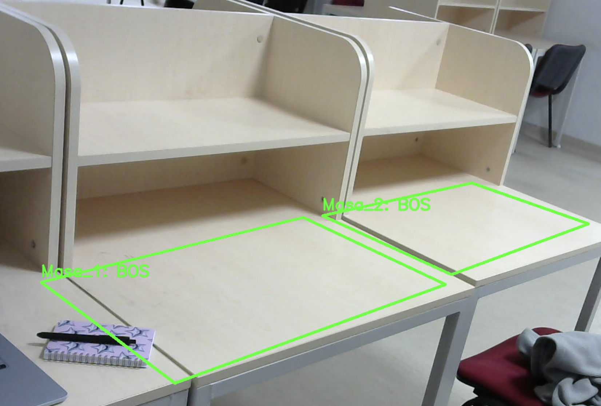
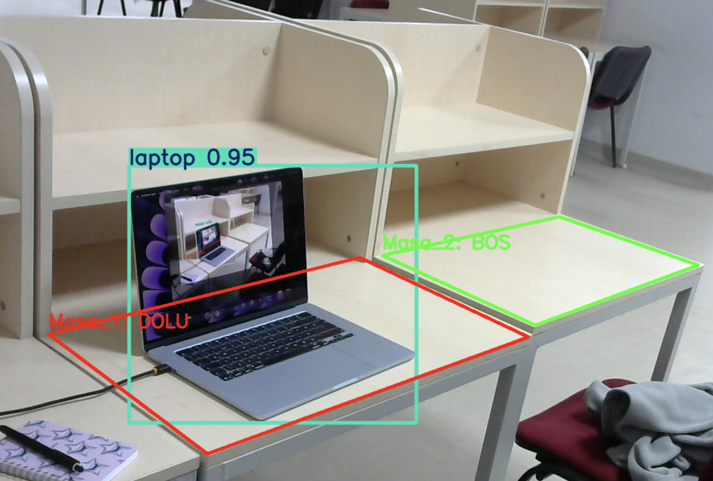
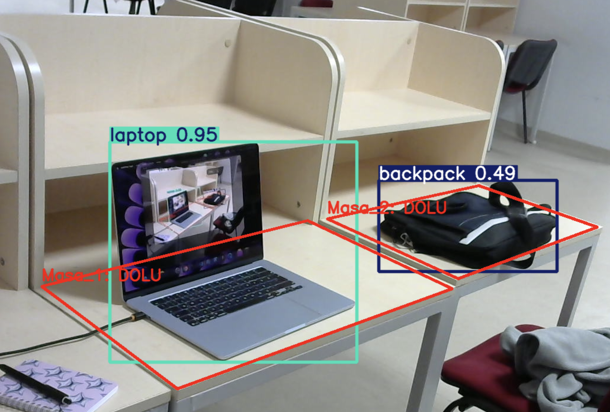

# DeskFinder

Kamera görüntüsündeki masa alanlarının boş veya dolu olduğunu takip eden Python uygulaması.

**Geliştirici:** [Enes](https://github.com/EnesAltuNN)

## Proje hakkında

DeskFinder, kütüphane ve çalışma alanlarındaki masaları görüntü üzerinden izler. Kullanıcı her masanın sınırlarını dört köşe noktasıyla tanımlar. YOLO tarafından algılanan hedef nesnelerden birinin merkezi bu alanın içinde kalırsa masa dolu, aksi durumda boş gösterilir.

Hedef nesneler: insan, sırt çantası, el çantası, şişe, fincan, dizüstü bilgisayar ve kitap.

Bu sürüm masa doluluğu takibine yönelik bir prototiptir. Gerçek bir otoparkta kamerayla canlı boş/dolu park yeri takibi, projenin sonraki geliştirme aşamasıdır; mevcut sürüm araç takibi yapmaz.

## Ekran görüntüleri

Görseller [Yukseltt/DeskFinder](https://github.com/Yukseltt/DeskFinder) deposundaki README'den alınmıştır.

**İki masanın da boş gösterildiği örnek:**



**Dizüstü bilgisayar algılandığında ilk masa dolu gösterilir:**



**Dizüstü bilgisayar ve sırt çantası algılandığında iki masa da dolu gösterilir:**



## Özellikler

- Kamera görüntüsü üzerinde boş/dolu alan gösterimi.
- Boş masalar için yeşil, dolu masalar için kırmızı sınırlar.
- Fare ile dört köşe seçerek masa alanlarını düzenleme.
- Alan koordinatlarını `config.json` dosyasında saklama.
- Ayarlanabilir nesne tespit güven eşiği.
- Tanımlanan alanların içindeki hedef nesnelerin kutularını gösterme.

## Kullanılan teknolojiler

- Python
- OpenCV: kamera, görüntü işleme ve masaüstü penceresi
- Ultralytics YOLO11: nesne tespiti (`yolo11s.pt`)
- NumPy: alan koordinatları
- JSON: yapılandırma dosyası

## Kurulum

Python 3.11 veya 3.12 ve Git kurulu olmalıdır. Özel depoyu klonlamak için GitHub hesabının depoya erişimi gerekir.

```powershell
git clone https://github.com/EnesAltuNN/DeskFinder.git
cd DeskFinder
```

### Windows / PowerShell

```powershell
python -m venv .venv
.\.venv\Scripts\python.exe -m pip install --upgrade pip
.\.venv\Scripts\python.exe -m pip install -r requirements.txt
.\.venv\Scripts\python.exe main.py
```

`python` komutu bulunamıyorsa Python kurulumunda PATH seçeneğini etkinleştirip terminali yeniden açın. Python başlatıcısı kuruluysa ilk komutta `python` yerine `py` kullanılabilir.

### macOS / Linux

```bash
python3 -m venv .venv
.venv/bin/python -m pip install --upgrade pip
.venv/bin/python -m pip install -r requirements.txt
.venv/bin/python main.py
```

Uygulamayı proje klasöründen çalıştırın. İlk açılışta `yolo11s.pt` dosyası bulunmuyorsa model indirilir; internet bağlantısı gerekir. Model ağırlıkları Git deposunda tutulmaz.

## Kamera ve görüntü kaynağı

Varsayılan kaynak, bilgisayarın ilk kamerasıdır:

```python
cap = cv2.VideoCapture(0)
```

Başka bir kaynak kullanmak için `main.py` içindeki bu satırı değiştirin:

```python
# İkinci kamera
cap = cv2.VideoCapture(1)

# Kayıtlı video
cap = cv2.VideoCapture("video.mp4")

# IP kameranın RTSP yayını
cap = cv2.VideoCapture("rtsp://KAMERA_ADRESI/YAYIN_YOLU")
```

Bu seçeneklerden yalnızca birini kullanın. Gerçek kamera parolalarını kaynak koda veya Git deposuna eklemeyin. Kamera bağlantısı kesildiğinde mevcut uygulama sonlanır; otomatik yeniden bağlantı henüz yoktur.

## Masa alanlarını ayarlama

`config.json` her masanın adını ve dört köşesinin piksel koordinatlarını içerir:

```json
{
  "Masa_1": [[50, 50], [300, 50], [300, 250], [50, 250]],
  "Masa_2": [[330, 50], [580, 50], [580, 250], [330, 250]]
}
```

Bu koordinatlar yalnızca örnektir. Depodaki koordinatlar da kendi kamera görüntünüze göre düzenlenmelidir. `config.json` yoksa uygulama varsayılan bir masa tanımıyla dosyayı oluşturur.

1. Uygulamayı açın ve görüntü penceresine odaklanın.
2. İlk masa için `1`, ikinci masa için `2` tuşuna basın.
3. Masanın dört köşesine, çevresini takip edecek sırayla tıklayın.
4. Dördüncü tıklamayla koordinatlar kaydedilir ve normal izleme devam eder.

Yeni bir masa eklemek için `config.json` dosyasına yeni bir kayıt ekleyip uygulamayı yeniden başlatın. Klavyeyle düzenleme ilk dokuz alan için `1`–`9` tuşlarıyla yapılır. Kamera açısı veya görüntü çözünürlüğü değişirse koordinatları yeniden ayarlayın.

## Kontroller

| Kontrol | İşlev |
| --- | --- |
| `1`–`9` | İlgili masa için alan düzenleme modunu açar |
| Sol fare tuşu | Düzenleme modunda köşe ekler; normal modda koordinatı terminale yazdırır |
| `q` | Uygulamadan çıkar |

## Ayarlar

| Ayar | Varsayılan | Açıklama |
| --- | --- | --- |
| Model | `yolo11s.pt` | Kullanılan nesne tespit modeli |
| `CONF_THRESHOLD` | `0.40` | Nesne tespiti için minimum güven skoru |
| `CONFIG_FILE` | `config.json` | Masa alanlarının saklandığı dosya |
| `TARGET_CLASSES` | `0, 24, 26, 39, 41, 63, 73` | Takip edilen nesne sınıfları |

Hesaplama cihazı için Ultralytics'in varsayılan seçimi kullanılır; macOS'a özel `mps` zorlanmaz. Cihazı elle seçmek için `main.py` içindeki `model(...)` çağrısına `device="cpu"` veya uygun donanım ve PyTorch kurulumuyla `device=0` eklenebilir.

## Proje dosyaları

```text
DeskFinder/
├── docs/images/      # Örnek ekran görüntüleri
├── main.py           # Kamera, nesne tespiti ve alan düzenleme
├── config.json       # Masa alanlarının koordinatları
├── requirements.txt  # Python bağımlılıkları
├── .gitignore        # Git dışında bırakılan yerel dosyalar
└── README.md         # Kurulum ve kullanım
```

## Mevcut sınırlamalar

- Doluluk kararı tek görüntü karesine ve nesnenin merkez noktasına dayanır.
- Düşük ışık, örtüşen nesneler ve uygun olmayan kamera açısı tespit hatalarına yol açabilir.
- Kamera üzerinde gerçek kullanım doğrulaması yapılmadan doğruluk veya çalışma hızı garantisi verilmez.
- Web paneli, mobil uygulama, geçmiş kayıtları ve çoklu kamera yönetimi bu sürümde bulunmaz.
